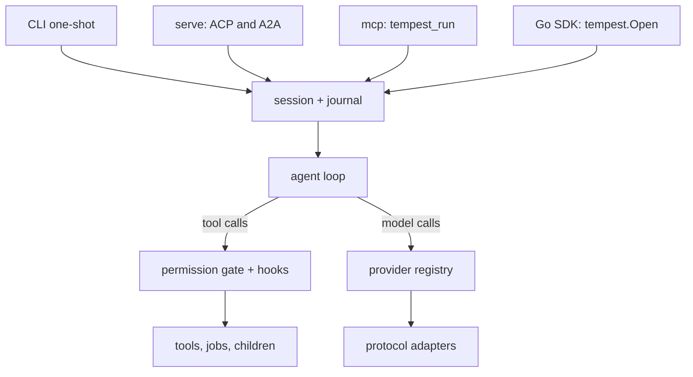

<h1 align="center">Tempest</h1>

<p align="center"><strong>A coding agent you can run, resume, and embed as one Go binary.</strong></p>

Tempest is an open-source coding agent that reads and edits files, runs commands,
and works turn by turn until the job is done. It runs from your terminal, serves
agent protocols, or embeds in a Go application, without a Node runtime or interpreter.

## At a glance

- **One static Go binary**, with no runtime dependencies for the harness itself.
- **Every model route in one harness**: 20 endpoint presets, six protocol adapters, custom endpoints, and exact model IDs.
- **Crash-safe durable sessions** that never silently re-run a side effect whose outcome is unknown.
- **Hashline edits** anchored to the file you read, with atomic writes and batch rollback recovery.
- **Permissions and plan mode**, with per-call guards for destructive commands and cloud changes.
- **Subagents in worktrees**, with durable jobs, messages, and explicit three-way integration.
- **Claude Code-compatible hooks**, with explicit trust for project commands.
- **Checkpoint and rewind**, restoring files and branching the conversation without touching your Git index.
- **Persistent eval kernels** for Python and JavaScript, started only when needed.
- **ACP, A2A, MCP, and a Go SDK**, sharing durable sessions, permissions, and cost budgets with billed cost.

## Contents

- [Architecture](#architecture)
- [Install](#install)
- [Quick start](#quick-start)
- [Features](#features)
- [Configuration](#configuration)
- [Embedding](#embedding)
- [Development](#development)
- [Guide](guide/README.md)
- [License](#license)

## Architecture

All entry points open the same session stack. The agent loop writes to the journal,
runs tools through the permission gate and hooks, and calls the provider registry.



## Install

Build from source with **Go 1.26.4 or newer**:

```sh
git clone https://github.com/parthshr370/tempest.git
cd tempest
CGO_ENABLED=0 go build -o bin/tempest ./cmd/harness
```

Copy `bin/tempest` onto your `PATH`. The harness needs no runtime installation.
Tools that invoke Git, language servers, or eval interpreters need those programs
only when used. See the [guide](guide/README.md) for the full reference.

## Quick start

From the checkout:

```sh
export OPENROUTER_API_KEY=...
./bin/tempest -model 'openrouter:~google/gemini-flash-latest' -p "Explain this project"
./bin/tempest -continue -p "Create hello.txt with hi"
./bin/tempest doctor
```

`-continue` opens the latest session in the current directory. Use `-resume <id>`
for a specific session. Export credentials yourself; Tempest does not load `.env`.
See [providers](guide/providers.md) for model routes and credentials.

## Features

### Providers and budgets

- **Exact model IDs**, separate from endpoint, protocol, and catalog metadata.
- **20 endpoint presets**, plus custom routes for OpenAI-compatible, Responses, Bedrock, and Vertex endpoints.
- **Model roles** for normal work, read-only planning, and small investigations.
- **Billed cost first**, catalog prices as fallback, and unknown prices kept unknown.
- **Catalog-aware limits**, shared across vendor protocols, with context-aware output clamping and configured overrides for unlisted models.
- **Run budgets** for model calls, USD cost, and elapsed time.
- **Prompt caching** and typed transient-error retries where the route supports them.

[Provider reference](guide/providers.md) · [Run behavior](guide/sessions-and-durability.md#runs)

### Files and code

- **Hashline patches** use numbered reads and content tags, not copied old text.
- **Atomic file writes** and rollback journals protect multi-file mutations.
- **Bounded reads and search** include archives, documents, JSON queries, and internal URLs.
- **Language servers** provide definitions, references, rename plans, and fresh diagnostics.
- **Manifest diffs** compare rendered Kubernetes resources without running a renderer.

[Tool reference](guide/tools.md) · [Code intelligence](guide/code-intelligence.md)

### Sessions and safety

- **Append-only journals** record tool starts before execution and preserve unknown outcomes.
- **Plan mode** rejects mutations before allow rules or remembered approvals.
- **Destructive and cloud guards** ask per call; they are guardrails, not a sandbox.
- **Checkpoint and rewind** restore protected files and retain an auditable conversation branch.
- **Text, JSON, or NDJSON output**, with locally validated structured final answers.

[Sessions and durability](guide/sessions-and-durability.md) · [Permissions](guide/permissions.md) · [Checkpoints](guide/checkpoints.md)

### Agents and automation

- **Opt-in subagents** investigate read-only or code in detached worktrees when eligible.
- **Explicit integration** merges child patches against their pinned base, with conflict reporting.
- **Named jobs and services** support readiness checks, logs, cancellation, stdin, and PTYs.
- **Trusted hooks and skills** add workflow rules without loading every skill body into the prompt.
- **Persistent eval kernels** keep per-language state across prompts, not across restart or rewind.

[Subagents and jobs](guide/subagents.md) · [Hooks](guide/hooks.md) · [Skills](guide/skills-and-context.md) · [Eval](guide/eval.md)

### Protocols

- **ACP** over stdio or authenticated WebSocket, with snapshots and reconnectable progress.
- **A2A 1.0** over HTTP for run-oriented tasks and discovery.
- **MCP client tools** from explicitly configured, trusted servers.
- **MCP server** over stdio, exposing `tempest_run` to other clients.

[Servers and protocols](guide/serve-and-protocols.md)

## Configuration

Flags override `HARNESS_*` environment variables, which override
`~/.config/harness/settings.json`, which overrides defaults.
Optional tools are enabled explicitly, including `-enable-task`, `-enable-web`,
and `-enable-lsp`. Provider endpoints come from presets, the `providers` registry,
or an `@<base-url>` model override.

See [configuration](guide/configuration.md) for flags, environment variables,
settings, and precedence. Run `./bin/tempest -help` for command help.

## Embedding

Import `go.harness.dev/harness/tempest` to open sessions, watch updates, prompt,
cancel, and close from Go. CLI, servers, and SDK use the same session stack.

See the [SDK guide](guide/sdk.md) and [complete embedding example](examples/embed/main.go).

## Development

```sh
go build ./...
go test ./...
make check   # build, vet, tests, and race checks
make smoke   # scratch-workspace run with the faux provider
```

The [testing guide](guide/testing.md) covers scripted runs without credentials.
The [education tour](education/README.md) explains the agent loop, providers,
tools, configuration, permissions, concurrency, and idiomatic Go design.

## License

**MIT**. See [LICENSE](LICENSE) and [THIRD_PARTY_NOTICES](THIRD_PARTY_NOTICES).
Behavior is ported from [Pi](https://github.com/badlogic/pi-mono) by
[Mario Zechner](https://github.com/mariozechner), extended via
[oh-my-pi](https://github.com/can1357/oh-my-pi) by Can Bölük.
