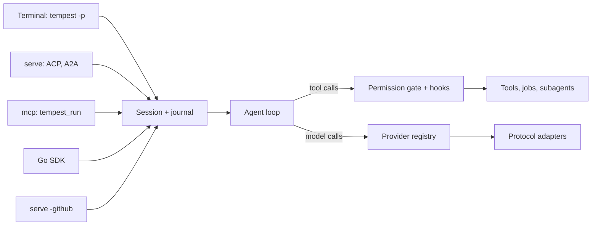
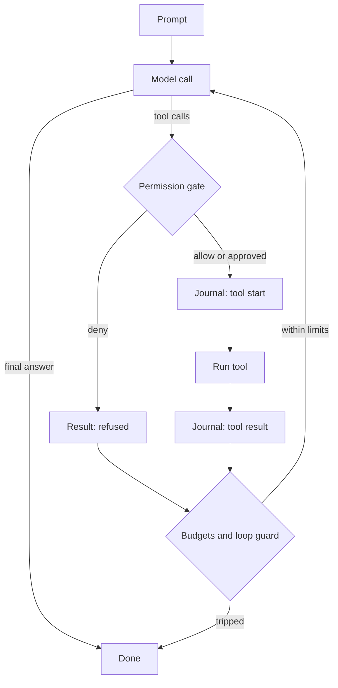
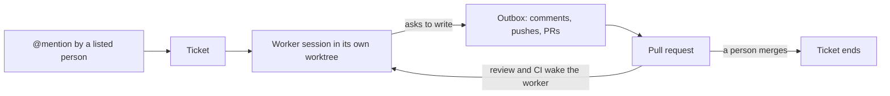

<p align="center">
  
</p>

<h1 align="center">Tempest</h1>

<p align="center"><strong>An open-source coding agent in one Go binary. Run it, resume it, embed it.</strong></p>

<p align="center">
  <a href="LICENSE"></a>
  <a href="go.mod"></a>
  <a href="https://github.com/parthshr370/tempest"></a>
  <a href="https://github.com/parthshr370/tempest/commits/main"></a>
</p>

<p align="center">
  <a href="#quick-start">Quick start</a> ·
  <a href="#features">Features</a> ·
  <a href="#use-it-from">Use it from</a> ·
  <a href="guide/README.md">Guide</a>
</p>

Tempest reads your code, edits files, runs commands, and keeps working turn by turn
until the task is done. It ships as a single static Go binary, with no Node or Python
runtime to install. Every session is written to an append-only journal, so you can
stop, crash, or resume without losing work or silently repeating a side effect. The
same engine runs in your terminal, serves editors and other agents, embeds in Go
programs, and works GitHub issues from an `@mention`.

## Why Tempest

- **One static binary.** Build it once and copy it anywhere. Git, language servers and eval interpreters are needed only by the tools that call them.
- **Any model.** 21 endpoint presets over 6 protocol adapters: Anthropic, OpenAI, Google, OpenRouter, Bedrock, Vertex, Azure, local Ollama, LM Studio, vLLM, llama.cpp and more, plus custom endpoints and backup models.
- **Sessions that survive crashes.** Each tool call is journaled before it runs. Resume any session; an action whose outcome is unknown is reported, never quietly run again.
- **Edits anchored to what was read.** Hashline patches name line numbers and a content tag from the model's last read. A stale view is rejected instead of writing to the wrong place, and a multi-file patch is validated before any file is written.
- **Guardrails built in.** Permission modes, a read-only plan mode, and per-call approval for destructive shell commands and cloud changes.
- **Subagents in worktrees.** Child agents investigate read-only or write code in their own Git worktree; their patches merge back explicitly, with conflicts reported.
- **Speaks the protocols.** ACP for editors, A2A and MCP for other agents, a Go SDK for your programs, and a GitHub ticket runner that turns mentions into pull requests.

## Install

Build from source with Go 1.26.4 or newer:

```sh
git clone https://github.com/parthshr370/tempest.git
cd tempest
CGO_ENABLED=0 go build -o bin/tempest ./cmd/harness
```

Copy `bin/tempest` onto your `PATH`.

## Quick start

```sh
export OPENROUTER_API_KEY=...
./bin/tempest -model 'openrouter:~google/gemini-flash-latest' -p "Explain this project"
./bin/tempest -continue -p "Create hello.txt that says hi"
./bin/tempest doctor
```

Each `-p` runs one prompt and exits. `-continue` picks up the latest session in this
directory with its model; `-resume <id>` opens a specific one. `doctor` checks your
configuration and credentials offline. Tempest does not read `.env` files, so export
credentials yourself. See [providers](guide/providers.md) for every model route.

## How it fits together

Every entry point opens the same session stack. Tool calls pass one permission gate;
model calls go through one provider registry.



## The agent loop

A run repeats one cycle until the model answers without calling a tool, a budget
trips, or the loop guard sees repeated work with no progress.



## GitHub ticket runner

`tempest serve -github owner/repo` polls one repository as a dedicated account and
takes work from a listed person's mention through to a pull request. Merging stays manual.



Workers hold no GitHub write credential, and every write goes through an outbox that
never blindly resends. There is no sandbox: run it on trusted repositories under a
dedicated OS account. See the [GitHub ticket runner guide](guide/github.md).

## Features

**Models and cost** · [providers](guide/providers.md)
- Custom endpoints via the `providers` settings or `@<base-url>` on the model ID.
- Model roles for normal work, read-only planning and small helper tasks.
- Backup models (`-fallback-model`) take over when a model is unavailable.
- Run budgets on turns, USD, wall time, tokens and tool calls (`-max-cost`, `-max-turns`, ...).
- Billed cost first, catalog prices as fallback, unknown prices kept unknown.

**Files and code** · [tools](guide/tools.md) · [code intelligence](guide/code-intelligence.md) · [eval](guide/eval.md)
- Hashline and exact-text edits, atomic writes, rollback for multi-file changes.
- Bounded reads and search across code, archives, documents and JSON.
- Language servers (`-enable-lsp`) for definitions, references, renames and diagnostics.
- Persistent Python and JavaScript eval kernels, started on first use.

**Sessions and safety** · [durability](guide/sessions-and-durability.md) · [permissions](guide/permissions.md) · [checkpoints](guide/checkpoints.md) · [conversations](guide/conversations.md)
- Append-only journals; resume with `-continue` or `-resume <id>`.
- Modes `plan`, `default`, `acceptEdits`, `bypass`; guards are guardrails, not a sandbox.
- Checkpoints with `rewind`, plus `fork`, `reset`, `compact` and `history`.
- Text, JSON or streaming JSON output, and answers validated against `-output-schema`.

**Agents and workflow** · [subagents](guide/subagents.md) · [hooks](guide/hooks.md) · [skills](guide/skills-and-context.md) · [extensions](guide/extensions.md)
- Subagents (`-enable-task`), and agent types defined as files (`tempest agents list`).
- Background jobs and services with readiness checks, logs, stdin and PTYs.
- Claude Code-compatible hooks; project hooks run only after you trust them.
- Skills and `AGENTS.md` / `CLAUDE.md` context; Go and subprocess extensions.

**Protocols and operations** · [servers](guide/serve-and-protocols.md) · [telemetry](guide/telemetry.md) · [environments](guide/environments.md)
- ACP over stdio or WebSocket, and A2A 1.0 over HTTP.
- MCP client with OAuth sign-in; large tool sets load on demand. MCP server via `tempest mcp`.
- OpenTelemetry traces and metrics, and Prometheus `/metrics` on `serve`.
- Remote workspaces through a workspace daemon (`tempest env`).

## Use it from

| Where | How |
|---|---|
| Terminal | `tempest -p "..."`, then `tempest -continue -p "..."` |
| Editor (ACP) | `tempest serve` speaks ACP over stdio |
| Remote clients (ACP WebSocket, A2A) | `TEMPEST_TOKEN=... tempest serve -listen 127.0.0.1:7777` |
| MCP clients | `tempest mcp` exposes one tool, `tempest_run` |
| Go code | import `go.harness.dev/harness/tempest` ([SDK guide](guide/sdk.md), [example](examples/embed/main.go)) |
| GitHub | `tempest serve -github owner/repo -github-config /abs/file.json` |

With a token, `serve -listen` requires it on every connection. Without one it stays on
loopback and refuses foreign browser origins, which is not authentication. See
[servers and protocols](guide/serve-and-protocols.md).

## Configuration

Settings layer from defaults through `~/.config/harness/settings.json`, project
`.harness/settings.json`, profiles (`-profile`), `HARNESS_*` variables, flags and
`-c key=value`. `tempest config show` prints each effective setting and where it came
from. Details are in the [configuration guide](guide/configuration.md).

## Development

```sh
make check   # build, examples, vet, tests and race tests
make smoke   # a scripted run in a scratch workspace, no credentials needed
```

The [testing guide](guide/testing.md) covers scripted runs with the faux provider,
and the [education tour](education/README.md) walks through the codebase.

## License

MIT. See [LICENSE](LICENSE) and [THIRD_PARTY_NOTICES](THIRD_PARTY_NOTICES).
Behavior is ported from [Pi](https://github.com/badlogic/pi-mono) by
[Mario Zechner](https://github.com/mariozechner), extended via
[oh-my-pi](https://github.com/can1357/oh-my-pi) by Can Bölük.

Banner: [Mountain Landscape with Lightning](https://www.nationalgallery.org.uk/paintings/francisque-millet-mountain-landscape-with-lightning)
by Francisque Millet, c. 1675, National Gallery, London. The painting is in the
public domain; the banner is a crop of a public domain reproduction.
[Star history](https://star-history.com/#parthshr370/tempest&Date).
