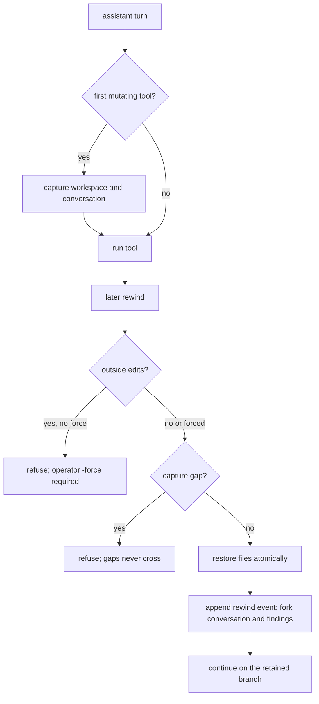

# Checkpoint and rewind

Before the first file-mutating call in each assistant turn, Tempest attempts a
checkpoint in a session-private Git store. Your index, HEAD, branches and stash stay
untouched. Git's private index stat cache keeps repeated captures incremental,
including in non-Git workspaces without creating `.git`.

## Lifecycle

A capture runs before the first mutating tool of a turn. Rewind restores the files
and appends a conversation fork, retaining the findings.



The model can also call `checkpoint` with an investigation goal, then `rewind` with
findings to retain.

```sh
tempest rewind -session <id> -list
tempest rewind -session <id> -checkpoint <checkpoint-id>
```

## Rewind behavior

Rewind restores files **and** forks the conversation by appending a journal event.
The discarded branch remains auditable.

- Outside edits require explicit `-force`.
- Settle running jobs and children first. Force never bypasses this guard or a
  capture gap.
- Capture failures never block tools or replace their results. They record a gap
  that older rewinds cannot cross, including after crash and resume.
- New checkpoints retain the application-state cut. Rewind restores namespaces
  with `history=rewindable`. It leaves `latest` documents, permission grants,
  queued submissions and lifetime spend unchanged. It also changes the context
  epoch so an older background summary cannot replace the rewound context.

## Bounds

- Ignored files, symlinks, nested repositories and files over 8 MiB are not
  protected.
- Skipped paths get notes and are never overwritten or deleted by rewind.
- No workspace file-count or total-byte limit refuses a large repository.

## Retention and selection

Automatic and explicit checkpoints have separate **32-entry retention rings**. An
omitted id selects the newest explicit checkpoint, otherwise the newest automatic
one.

Only operators can force outside edits. Neither checkpoint nor rewind is exposed to
the model in plan mode.

## Clients

- Go SDK: `CreateCheckpoint`, `Checkpoints` and `Rewind`.
- ACP: `tempest/checkpoint`, `tempest/checkpoints` and `tempest/rewind` with
  `sessionId`.

See [sessions and durability](sessions-and-durability.md) for journal recovery.

[Guide index](README.md) · [Tempest](../README.md)
