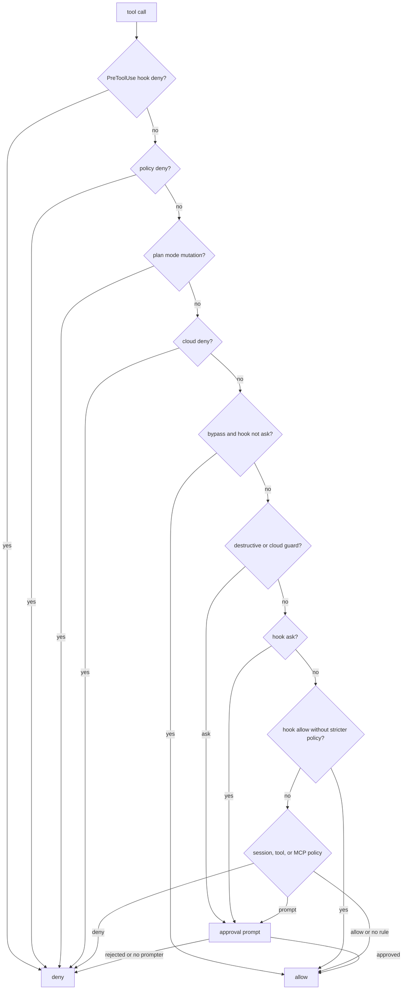

# Permissions

Every tool call passes one chokepoint. Each tool carries a **tier**, and the
permission mode sets the baseline. Outside `bypass`, extra guards add per-call
approval for destructive shell commands and cloud changes.

## Decision flow

The gate checks in order, and the first decisive check wins. Deny rules and plan
mode come before any allow. Guard and cloud asks prompt per call.



## Modes and tool tiers

Each tool is `read`, `write`, or `exec` tier. Modes set the baseline:

| Mode | Baseline |
|---|---|
| `plan` | Read-only. |
| `default` | Edits and non-destructive shell. |
| `acceptEdits` | Edits and non-destructive shell. |
| `bypass` | Everything you do not explicitly deny. |

Set the mode with `-permission-mode` or `HARNESS_PERMISSION_MODE`. Per-tool
overrides use `-allow-tool` and `-deny-tool` (deny wins), or
`HARNESS_PERMISSION_ALLOW_TOOLS` and `HARNESS_PERMISSION_DENY_TOOLS`.

## Destructive-command guard

Outside `bypass`, the shell guard requires approval for:

- deleting files or directories;
- overwriting or truncating existing files;
- in-place edits;
- destructive git operations: `reset --hard`, `clean -f`, `checkout -- <path>`,
  `restore`, force push, and `branch -D`.

It catches direct removals, `find -delete` and `-exec rm`, `xargs rm`, `sed -i`,
`perl -i`, `truncate`, `dd of=`, and `shred`. Existing protections for dangerous
system commands, package-changing commands, and fork bombs remain.

What does **not** need guard approval:

- Appends (`>>`, `tee -a`).
- Writes to new redirect, `tee`, `cp`, or `mv` targets.
- `git stash`, because it is reversible. Discarding stashes with `drop` or `clear`
  still asks.

Targets resolve relative to the command's working directory. Copying or moving into
a directory checks the resulting destination file. If the guard cannot determine
whether a target exists, it asks. Plan mode still rejects non-destructive writes.

The guard also recognizes obvious deletion or overwrite calls in `python -c`,
`python3 -c`, `node -e`, `perl -e`, and `ruby -e` code, including `rmtree`,
`os.remove`, `unlink`, `rmdir`, `fs.rm`, `unlinkSync`, and `open(..., 'w')`.

This is a guardrail, **not a sandbox**. Arbitrary scripts, obfuscated code, and shell
expansions cannot be fully classified, and existence checks are not atomic with
execution. Guard approval runs before ordinary allow and Always choices. Even an
Always answer applies only once, and the next destructive call asks again. Without
an interactive prompter, guarded commands are denied.

## Cloud commands

Inside the same bash gate, `kubectl`, `helm`, `terraform` and `kustomize`
invocations are classified as **read**, **write**, **destructive** or **opaque**,
without running anything or reading your kubeconfig.

| Class | Examples | Behavior |
|---|---|---|
| Read | `kubectl get`, `helm list`, `terraform show` | Allowed as before. |
| Write | `kubectl apply`, `helm upgrade --install`, `terraform plan` or `apply`, any `--dry-run` | Prompts per call in `default` and `acceptEdits`, even with `-allow-tool bash`. Accepting code edits is not consent to deploy. |
| Destructive | `kubectl delete`, `helm uninstall`, `terraform destroy` | Per-call guard approval. |
| Opaque | Unknown verbs or flags, `kustomize build`, environment changes in front of a cloud tool, syntax the classifier cannot resolve | Prompts. |

Literal wrappers and inline shells are looked through: `timeout 30 kubectl get pods`
and `bash -c 'kubectl get pods'` are reads, while `timeout 5 kubectl delete pod x`
is destructive.

Opaque forms prompt when the command names a cloud tool anywhere. That includes
`KUBECONFIG=x kubectl …`, substitutions, here-documents, loops, `xargs`, `sudo`, a
dynamic command word (`$K get pods`), `eval "$x"`, `bash -c "$CMD"`, and
`curl … | sh`.

Commands that name no cloud tool keep their previous behavior whatever syntax they
use, so `go test $(go list ./...)`, `cat <<EOF > main.go`, `timeout 30 make` and
`find . | xargs grep x` run as before. Compound commands are judged by their
riskiest part, and an Always answer never covers a later cloud call. Without an
approver, all of these are denied.

### Cloud policy file

An operator can pre-approve or forbid exact kube contexts with `-cloud-policy FILE`
(`HARNESS_CLOUD_POLICY`, settings `cloud_policy`):

```json
{"rules":[
  {"tool":"kubectl","context":"kind-dev","action":"allow_write"},
  {"tool":"helm","context":"kind-dev","action":"allow_write"},
  {"tool":"kubectl","context":"production","action":"deny"}
]}
```

`allow_write` lets a non-destructive write run without a prompt only when the
command itself names that context literally (`kubectl --context kind-dev apply …`,
`helm --kube-context kind-dev upgrade …`). An ambient current context, a
`--kubeconfig`/`--server`/credential override, a dynamic value, or a call made
through a wrapper, substitution or `bash -c` never matches.

`deny` wins over everything, including `bypass`, and also blocks reads. When a deny
rule exists for a tool and the target context cannot be established, that call is
denied too.

Contexts are exact names, not patterns. At most 256 rules, with a 1 MiB file. Rules
cover `kubectl` and `helm` only, and a context name is policy within your trusted
kubeconfig, not a verified cluster identity.

## Plan mode

**Plan mode cannot be overridden.** `plan` denies every mutation before any allow
rule, remembered approval or cloud grant is consulted. `-allow-tool bash` no longer
lets a plan run write.

Only commands proven read-only in every part run in plan mode, in plain syntax.
Substitutions, here-documents, wrappers and `bash -c` are refused there even when
they name no cloud tool.

[Guide index](README.md) · [Tempest](../README.md)
