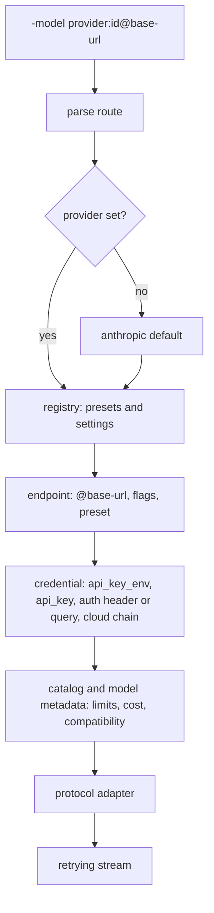

# Providers

Tempest keeps one model registry and one set of protocol adapters for every route.
A model ID is the endpoint's exact route ID, never rewritten or normalized. Four
concepts stay separate:

| Concept | Meaning |
|---|---|
| **Model** | The endpoint's exact route ID. |
| **Endpoint** | The HTTP service and credential that serve that ID. An explicit `@<base-url>` overrides the configured endpoint. |
| **Protocol adapter** | `anthropic`, `openai-chat`, `google`, `openai-responses`, `bedrock`, or `vertex`. |
| **Catalog metadata** | Embedded context and output limits, capabilities, compatibility controls, and USD-per-million prices. Catalog membership is not proof of endpoint access, protocol compatibility, or account permission. |

Unknown model IDs still run with protocol fallback limits and **unknown price**, not a
fabricated free price. Chat-compatible, Responses and Bedrock routes assume a
128,000-token context; Anthropic and OpenRouter use 200,000, and Google and Vertex
use 1,048,576. These fallbacks are not a model specification.
Configure `models[].contextWindow` and `maxTokens` for an unlisted model's actual
limits. Every protocol reserves room for the estimated prompt and a
4,096-token safety margin, and caps requested output at the model's output limit.
Computed JSON costs encode `{"unknown":true}` rather than zero-dollar components.
Unknown provider prefixes are configuration errors. Bare IDs use the Anthropic route.

## Routes

`-model` selects the model. The shape is `<provider>:<model-id>`, with an optional
`@<base-url>` override:

| Route | Credential | Notes |
|---|---|---|
| `<id>` | `ANTHROPIC_API_KEY` | Bare IDs use the Anthropic route. |
| `anthropic:<id>` | `ANTHROPIC_API_KEY`, `ANTHROPIC_OAUTH_TOKEN`, `ANTHROPIC_AUTH_TOKEN` | Anthropic Messages. |
| `google:<id>` | `GEMINI_API_KEY` or `GOOGLE_API_KEY` | Google Generative AI. Point it elsewhere with `google:<id>@<base-url>`. |
| `openrouter:<id>` | `OPENROUTER_API_KEY` | OpenAI Chat Completions with OpenRouter's endpoint. Model IDs may carry a `~` prefix. Point it elsewhere with `openrouter:<id>@<base-url>`. |
| `openai:<id>` | `OPENAI_API_KEY` | Endpoint comes from `-openai-base-url`, `HARNESS_OPENAI_BASE_URL`, settings `openai_base_url`, or `OPENAI_BASE_URL`, in that order. |
| `openai:<id>@<base-url>` | `OPENAI_API_KEY` | Explicit endpoint override. |
| `<custom>:<id>` | Depends on the registry entry | Any route configured in the `providers` registry. |

The model ID is opaque and endpoint-specific: `claude-fable-5-1` on Anthropic
differs from `anthropic/claude-fable-5.1` on OpenRouter, whose aliases include a
literal `~` prefix.
Only `@http://` or `@https://` starts an endpoint override. Vertex version IDs such as
`vertex:claude-haiku-4-5@20251001` keep their version suffix.


### Route resolution

The router parses the route, looks up the provider registry, resolves the endpoint
and credential, applies catalog and model metadata, then selects the protocol
adapter.



## Endpoint registry

Define or override endpoints in `~/.config/harness/settings.json` under `providers`,
keyed by lowercase route name:

```json
{
  "providers": {
    "local": {
      "protocol": "openai-chat",
      "base_url": "http://localhost:8080/v1",
      "api_key_env": "LOCAL_API_KEY",
      "compatibility": {"supportsPromptCacheKey": false}
    }
  }
}
```

| Field | Meaning |
|---|---|
| `protocol` | One of `openai-chat`, `anthropic`, `google`, `openai-responses`, `bedrock`, `vertex`. |
| `base_url` | Endpoint origin or base URL. Each protocol decides how much path it appends. |
| `api_key_env` | Name of the environment variable holding the key, never the key itself. |
| `api_key` | Fallback key. The environment variable wins. |
| `headers` | Extra request headers. |
| `query` | Extra query parameters. |
| `auth_header` | Header used for the credential. |
| `auth_query` | Query parameter used for the credential. The runtime key becomes the query value and no bearer is sent. |
| `auth_prefix` | Prefix before the key. Defaults to `Bearer ` (with the space); an explicit empty string sends the raw key. |
| `no_auth` | Skips credential lookup. |
| `compatibility` | Endpoint quirks, in camelCase. See [Compatibility keys](#compatibility-keys). |
| `models` | Per-model metadata: `id`, `name`, `contextWindow`, `maxTokens`, `reasoning`, `input`, and `cost` (`input`, `output`, `cacheRead`, `cacheWrite`). Only supplied fields override catalog defaults. A model's `maxTokens` caps the startup limit, even when a larger default is in effect. An absent cost preserves a catalog price, or stays unknown when none exists. JSON can explicitly set a zero-dollar cost; an all-zero Go model literal without JSON field presence does not declare a free model. |

A preset supplies defaults for its fields. A registry entry may override one field
or add a new route. A new route needs a `protocol` and, for protocols that need one,
a `base_url`.

### Compatibility keys

`compatibility` accepts these camelCase keys:

| Key | Values | Effect |
|---|---|---|
| `reasoningDisableMode` | Provider-specific | How reasoning is turned off. |
| `maxTokensField` | `max_tokens`, `max_completion_tokens` | Output-limit field name. |
| `reasoningFormat` | `openai`, `openrouter`, `none` | How reasoning effort is sent. |
| `reasoningContentField` | `reasoning_content`, `reasoning`, `reasoning_text` | Field used to replay reasoning content alongside tool history. |
| `supportsPromptCacheKey` | boolean | Send `prompt_cache_key`; `false` omits it. |
| `supportsSessionId` | boolean | Send `session_id` for sticky routing. |
| `supportsUsageInStreaming` | boolean | Expect usage in stream events. |
| `supportsToolChoice` | boolean | Send `tool_choice: "auto"` when tools are available, or a caller's explicit tool choice. `false` omits the field. |
| `cacheControlFormat` | `anthropic`, `none` | Emit a top-level `cache_control` block. |
| `supportsEncryptedReasoning` | boolean | Include `reasoning.encrypted_content` and replay encrypted history; `false` omits both. A nil value keeps OpenAI behavior. |
| `requiresMistralToolIds` | boolean | Use Mistral's 9-character alphanumeric tool IDs. An explicit `false` overrides the preset. |

Most chat-compatible presets use `max_tokens` and no OpenAI prompt cache fields.
Mistral and Cerebras also send no `stream_options`. Ollama disables `tool_choice`.
`xai` is a chat-compatible preset today; set its protocol to `openai-responses` for
models that need the Responses API.

The Cerebras omission follows its [published request schema](https://inference-docs.cerebras.ai/api-reference/chat-completions),
which has no `stream_options` member. Mistral's [current validator](https://github.com/mistralai/mistral-common/blob/main/src/mistral_common/protocol/instruct/validator.py)
permits a user message directly after tool results, so the adapter doesn't insert a
fabricated assistant turn.

## Presets

| Route | Protocol | Credential | Default endpoint |
|---|---|---|---|
| `anthropic` | `anthropic` | `ANTHROPIC_API_KEY` | `https://api.anthropic.com` |
| `openai` | `openai-chat` | `OPENAI_API_KEY` | `https://api.openai.com/v1` |
| `google` | `google` | `GEMINI_API_KEY` | `https://generativelanguage.googleapis.com` |
| `openrouter` | `openai-chat` | `OPENROUTER_API_KEY` | `https://openrouter.ai/api/v1` |
| `groq` | `openai-chat` | `GROQ_API_KEY` | `https://api.groq.com/openai/v1` |
| `mistral` | `openai-chat` | `MISTRAL_API_KEY` | `https://api.mistral.ai/v1` |
| `xai` | `openai-chat` | `XAI_API_KEY` | `https://api.x.ai/v1` |
| `deepseek` | `openai-chat` | `DEEPSEEK_API_KEY` | `https://api.deepseek.com` |
| `together` | `openai-chat` | `TOGETHER_API_KEY` | `https://api.together.ai/v1` |
| `fireworks` | `openai-chat` | `FIREWORKS_API_KEY` | `https://api.fireworks.ai/inference/v1` |
| `cerebras` | `openai-chat` | `CEREBRAS_API_KEY` | `https://api.cerebras.ai/v1` |
| `perplexity` | `openai-responses` | `PERPLEXITY_API_KEY` | `https://api.perplexity.ai/v1` |
| `ollama` | `openai-chat` | none | `http://localhost:11434/v1` |
| `lmstudio` | `openai-chat` | none | `http://localhost:1234/v1` |
| `vllm` | `openai-chat` | none | `http://localhost:8000/v1` |
| `llamacpp` | `openai-chat` | none | `http://localhost:8080/v1` |
| `azure` | `openai-chat` | `AZURE_OPENAI_API_KEY` | `AZURE_OPENAI_ENDPOINT`, a deployment path, or `/openai/v1` |
| `openai-responses` | `openai-responses` | `OPENAI_API_KEY` | `https://api.openai.com/v1` |
| `bedrock` | `bedrock` | `AWS_BEARER_TOKEN_BEDROCK`, or AWS credentials | `https://bedrock-runtime.<region>.amazonaws.com` |
| `vertex` | `vertex` | Google service account or `GOOGLE_CLOUD_API_KEY` | `https://aiplatform.googleapis.com` (global) or `https://<location>-aiplatform.googleapis.com` |

The `deepseek` preset replays `reasoning_content` on every assistant turn, including
an empty string when thinking is unavailable after a model switch, as
[DeepSeek's thinking-mode documentation](https://api-docs.deepseek.com/guides/thinking_mode)
requires for requests with tools. The `perplexity` preset disables encrypted reasoning and
`prompt_cache_key`, avoiding OpenAI-only fields. Other Responses routes keep native
OpenAI behavior unless a compatibility flag sets it to `false`. The `google` preset
is the origin only; the adapter appends `/v1beta/models/<model>:streamGenerateContent`.

### Azure

Azure sends the key in `api-key` and uses `max_completion_tokens`, which
[Azure reasoning models require](https://learn.microsoft.com/en-us/azure/foundry/openai/how-to/reasoning).
A resource root gets `/openai/deployments/<model-id>/chat/completions` appended,
with `api-version=2025-04-01-preview`. A deployment-specific
`/openai/deployments/<name>` base URL works too. `AZURE_OPENAI_API_VERSION` overrides
only that query parameter, preserving other configured query parameters.

The current [Azure v1 API](https://learn.microsoft.com/en-us/azure/foundry/openai/api-version-lifecycle)
also works: set `base_url` or `AZURE_OPENAI_ENDPOINT` to
`https://RESOURCE.openai.azure.com/openai/v1/`. That path gets only
`/chat/completions` appended and no dated `api-version` parameter.

```json
{
  "providers": {
    "azure": {
      "base_url": "https://RESOURCE.openai.azure.com",
      "query": {"api-version": "2025-04-01-preview"}
    }
  }
}
```

Select it with `-model azure:<deployment>`.

## Project provider definitions

Provider definitions in `.harness/settings.json` and
`.harness/settings.local.json` **never apply without explicit operator trust**. Use
`-trust-project-providers`, `HARNESS_TRUST_PROJECT_PROVIDERS=true`, or add the
workspace's absolute canonical path to user `trusted_provider_projects`. A project
cannot grant itself trust.

An untrusted project definition is ignored entirely, including a definition that
would replace a built-in route, so a cloned repository cannot redirect a credential.
After opt-in, a project entry replaces a user entry of the same name, with
`settings.local.json` winning by name, and preset defaults merge field by field
underneath. An entirely new route is supported after opt-in.

Trust grants access to **any environment variable** named by a project's
`api_key_env`, not just built-in provider keys. A trusted project can send that value
to its configured endpoint, including a value such as `GITHUB_TOKEN`. Inspect the
project's provider definitions before granting trust.

## Protocol adapters

OpenRouter uses the OpenAI Chat Completions adapter with its own endpoint and key.
The adapters are `anthropic`, `openai-chat`, `google`, `openai-responses`, `bedrock`
and `vertex`. Each maps tools, images, reasoning and usage into the shared message
format. Responses, Bedrock and Vertex are covered by shared conformance tests and
isolated CLI runs against local fake servers; see [testing](testing.md#provider-conformance).

All protocol adapters normalize history before conversion: failed assistant
attempts are dropped, unanswered tool calls get synthetic results, foreign tool IDs
are normalized for the target protocol, and unsupported images become placeholders.

### OpenAI Responses

`openai-responses` posts to `/responses` with `store=false`. A model
`@<base-url>` override applies here and must include `/v1`. Reasoning-capable models
request `reasoning.encrypted_content`. Replay requires nonempty encrypted content
and the same provider and model; set `supportsEncryptedReasoning: false` to turn
both off. The session ID doubles as `prompt_cache_key`; IDs longer than 64 bytes
use their SHA-256 hex digest. Reasoning effort and summary are sent when configured
and supported by the model, and cached and reasoning token usage is read back.

### Bedrock

`bedrock` calls ConverseStream and receives the AWS binary event stream, with CRC
checks, using the standard library. With `Transport: "http"` it uses non-streaming
Converse instead. The model ID is passed verbatim as one escaped URL segment, so a
foundation model ID, an inference-profile ID, or an ARN all work.

Auth precedence:

1. An explicit API key or `AWS_BEARER_TOKEN_BEDROCK`.
2. `AWS_ACCESS_KEY_ID` with `AWS_SECRET_ACCESS_KEY` and optional
   `AWS_SESSION_TOKEN`, signed with SigV4.
3. Shared credentials from `~/.aws/credentials`, honoring `AWS_PROFILE` and
   `AWS_SHARED_CREDENTIALS_FILE`.

The origin defaults to `https://bedrock-runtime.<region>.amazonaws.com`, where the
region comes from `AWS_REGION` or `AWS_DEFAULT_REGION`. A model `@<base-url>`
override applies to the origin only. Tools, images and reasoning content are
mapped. Reasoning is signed and replayed. Thinking requests are sent only to
Anthropic models (IDs containing `anthropic`), with a budget or adaptive
compatibility, and Bedrock cache checkpoints are not created automatically.
Tool-result `status` is sent only to Claude 3 and 4 and Amazon Nova, as
[AWS documents](https://docs.aws.amazon.com/bedrock/latest/APIReference/API_runtime_ToolResultBlock.html).
Guardrail and content-filter stop errors retain their original stop reason.


### Vertex

`vertex` chooses the Anthropic adapter when the model ID starts with `claude-` or
contains `/anthropic/`, and the Gemini adapter otherwise. Gemini uses
`streamGenerateContent`; Claude uses `streamRawPredict`. With `Transport: "http"`,
Gemini uses `generateContent` and Claude uses `rawPredict` instead. Tools, images,
thinking signatures and cache usage follow those native converters.
Publisher resource IDs and full project resource IDs preserve their path separators.
A full `streamRawPredict` override selects Claude even when the model is an alias.
Vertex keeps configured `anthropic-beta` headers, including interleaved-thinking
betas.


Auth precedence:

1. An explicit `Authorization` header.
2. For Gemini only, a configured key or `GOOGLE_CLOUD_API_KEY` selects Express mode
   (`/v1/publishers/google/models/...`, no project). Claude skips this key and
   continues to the OAuth credential chain.
3. A service account JSON file from `GOOGLE_APPLICATION_CREDENTIALS`, with the
   project from `GOOGLE_CLOUD_PROJECT`, `GCLOUD_PROJECT`, or the account's
   `project_id`.
4. `gcloud config config-helper --format=json --min-expiry=60s`, used only when no
   service account is configured. Its active project is a fallback when no project
   environment variable is set.

`GOOGLE_CLOUD_LOCATION` defaults to `global`. A model `@<base-url>` override may be
an origin or a full `streamGenerateContent` or `streamRawPredict` endpoint. Service
account and gcloud OAuth tokens are cached until their reported expiry, with a
one-minute refresh margin. Tokens with no reported expiry are not cached.
`no_auth` skips the credential chain.

## Costs

Cost comes from the provider's bill when the route reports one. OpenRouter returns
each request's billed cost in its usage (`usage.cost`). With a bring-your-own-key
upstream, the request costs OpenRouter's fee plus
`cost_details.upstream_inference_cost`. That amount, which already prices cached and
cache-write tokens, is the call's cost and counts against `-max-cost`, so an
OpenRouter model needs no catalog entry for a cost budget.

Billed costs carry only a total, no per-component split. The catalog price is the
fallback when a response reports no billed cost. With neither, the call's cost stays
unknown.

## Prompt caching

Within a session, every request extends the previous one byte for byte: history is
only rewritten by compaction, and the tool list is in name order.

- On OpenAI's endpoint and on OpenRouter, each request carries the session id as
  `prompt_cache_key`.
- OpenRouter also gets it as `session_id`, its sticky-routing key, so later turns
  reach the endpoint that holds the cache.
- Claude models on OpenRouter get a top-level `cache_control`, without which they
  cache nothing.
- Other OpenAI-compatible endpoints get none of these fields unless their registry
  entry enables them.

## Catalog metadata

`internal/catalog/models.json` records import provenance (`generated_from`, `as_of`)
and each entry's `source` URL and `verified_at` date. Most direct-provider entries
retain the imported snapshot's date. GPT-5.6 Luna's route and metadata were checked
against OpenAI's model page on 2026-10-21. OpenRouter entries use the public
discovery snapshot from that date. Discovery confirms exact IDs and advertised
metadata, not a successful generation request.

Routes use the vendor family for catalog lookup without changing the wire model ID:
Responses uses OpenAI metadata, Vertex uses Google or Anthropic metadata (ignoring
the Claude `@version` suffix for lookup), and known Bedrock Anthropic model families
share Anthropic metadata. Perplexity's model IDs have no entries in the embedded
catalog and remain unknown-priced instead of inheriting unrelated OpenAI prices.

To validate the embedded JSON and the live IDs:

```sh
go test ./internal/catalog/...
TEMPEST_LIVE=1 go test ./internal/catalog/ -run TestVerifyOpenRouter
```

## Doctor

`./bin/tempest doctor` is offline and never prints credentials. It prints a one-line
catalog count, lists the provider registry with credential presence and whether auth
is required, and `-models` lists every catalog model with its prices. Keyless local
presets show `present=no auth_required=no`, not a pretend API key. Bedrock and Vertex
are not rejected offline for an absent API-key variable; `--ping` verifies the full
credential chain. Configured headers, query parameters and API keys are never
displayed.

`./bin/tempest doctor --ping` makes one billable request (prompt `hi`, output cap 16
tokens) to each configured model: the default model, plus the plan and smol models
when they differ. Each line names the roles and the exact model it pinged, then
latency on success, or the typed failure code with the provider's HTTP status and
bounded, redacted message, for example `provider HTTP 404: {...}` for an
account/endpoint restriction. A missing credential error names the configured
`api_key_env`.

## Output

Output is text by default. `-output-format json` prints a run report and
`-output-format stream-json` streams NDJSON updates followed by that report. See
[sessions and durability](sessions-and-durability.md#output-formats).

[Guide index](README.md) · [Tempest](../README.md)
