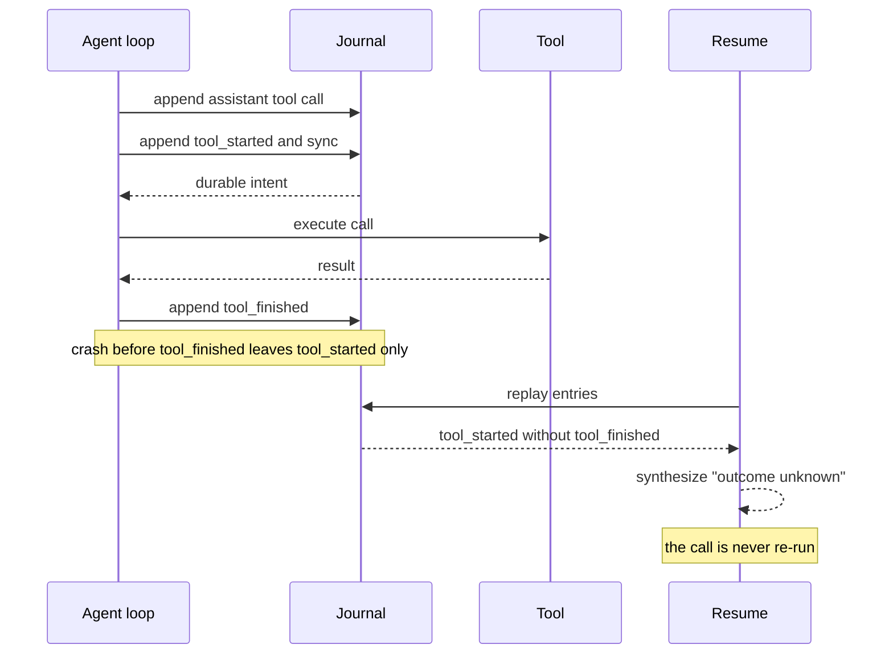

# Sessions and durability

A session is an append-only journal on disk. Runs can be resumed, rewound, served
over a protocol, or driven from Go, and all of them use the same journal and the
same recovery rules.

## Durable journals

Every run is journaled to an append-only JSONL file as it happens: each message,
each tool call's start and finish, per-call usage, and how the run ended. A tool's
start is on disk before the tool runs.

- `-continue -p "new input"` opens the most recent session for this directory.
- `-resume <id> -p "new input"` opens a specific session.
- Without `-p`, `-continue` or `-resume <id>` explicitly continues existing work.
  It resumes accepted input and reconciles interrupted tool calls using their
  recorded replay policy. Safe calls require a compatible implementation.
  Never calls report an unknown outcome instead of running again.
- The CLI prints the id on stderr in text mode and as `session_id` in JSON reports.
- You can pass the journal filename (with or without `.jsonl`) instead of the bare
  id. Ambiguous ids are rejected with filename hints.
- Sessions are isolated by working directory, so a resume never bleeds another
  project's history into yours.

If the process died mid-run, a tool call that had started but not finished comes
back to the model as **"outcome unknown"** and is never re-run automatically. A torn
final line is trimmed.

### Tool call journaling

The intent record is synced before the tool executes. On resume, a start with no
finish becomes an unknown outcome, not a retry.



### Journal format

Journals use format **v4**. Opening a v1, v2 or v3 journal migrates it under a
stable writer lock before new facts are written. Atomic batches include a checksum
and a prior sequence. A torn final batch is absent; invalid middle data is an error.
Older binaries refuse v4. Back up each journal with its lock, `.jsonl.blobs` and
`.jsonl.d` directories. Large transcript and submission batches use immutable,
content-addressed blobs; their references commit only after the blobs are synced.
Missing or modified blobs are corruption. Committed snapshots and child journals
are recovery data, not caches. The `.jsonl.catalog` metadata index is rebuildable.

The JSONL adapter retains the full raw committed history in memory. Read pages
have bounded sizes and immutable sequence cuts, but the adapter is not
disk-indexed and does not have a bounded memory working set. Context compaction
does not remove that retained history.

Fresh prompts in an open session reuse the writer's committed usage receipts;
they don't replay and checksum the entire archive at each run start. Explicit
continuation still loads the archive to recover interrupted logical-run state.

Document namespaces with the `latest` history policy allow only current-value
reads. Historical cuts, revision history, and cursors pinned before later commits
are rejected, including broad queries and extension callback reads.
The agent document stores the effective ordered extension selection, including
required subprocess bundles. Resume fails visibly if one is unavailable; it never
silently drops a safety bundle. Persisted tool choices intersect the operator's
current allowlist and exclusions, so a resume cannot restore removed authority.


### Durable prompt retries

Pass `-request-id KEY` to give a prompt a durable identity. You can retry the
identical command without adding `-continue` or `-resume`:

```sh
tempest -session-dir ./sessions -request-id fix-1 -p "fix the failing check"
```

With no explicit session selector, Tempest finds the session that already holds
the key in that session directory and working directory (the same scope as
`-continue`). It returns the original receipt and answer, or resumes accepted work.
Changed input conflicts; use the same prompt, images, output schema and placement.
A filesystem lock serializes concurrent commands for that key through session
close. A killed process releases the lock; the journal, not the lockfile, owns the
receipt. The rebuildable catalog index accelerates lookup; missing or stale index
data falls back to the committed journal.

With `-resume SESSION` or `-continue`, the selected session owns the key instead.
Keys in different explicitly selected sessions are independent. Text mode prints
the session and submission IDs after acceptance, before waiting for the answer.
JSON and stream-json final reports include `submission_id` and `request_id`.
The keyed CLI command explicitly resumes accepted input that never dispatched.
It does not replay a provider call whose outcome is unknown.

Same-key retries return the original submission, even after consumption,
withdrawal or restart. Changed input conflicts. A withdrawn request stays withdrawn.
A new request needs a new key. Keys have no silent expiry while the session exists.

Acceptance is synced before success is returned. Losing a connection or cancelling
a wait does not withdraw accepted input. After a crash, opening and reading remain
side-effect-free. Explicit continuation or host resume decides whether pending work
runs. Interrupted provider calls and outside effects are not exactly-once promises.

Application state uses the same commit boundary. Document writes support expected
revisions and atomic batches. A failed comparison adopts nothing. File storage
syncs commits; the memory backend deliberately has no crash-durability guarantee.


## Error handling

The run bends, it does not break. Transient provider failures (rate limits, resets,
timeouts) are sorted by a typed error taxonomy and retried with exponential backoff
and jitter. Only genuinely terminal conditions stop the loop, and context overflow
is handed off to compaction instead of failing.

Tool errors take the other road. A stale-anchor edit, a blocked destructive command,
a bad path, or a failing shell command each come back to the model as a clear,
actionable result, so it re-reads, re-anchors, and course-corrects on the next turn
instead of corrupting state.

## Runs

A run is one `-p` prompt. The model calls tools, sees their results, and keeps
going. A reply with no tool calls reaches **quiescence**: the run waits for owned
background jobs and consumes their result follow-ups before completing.

A result follow-up is a short host notice in the transcript: job id, kind, state,
exit code or reason, a bounded output or result preview, artifact paths, and the
`wait`/`logs` calls that return the full details. No detached next run is started
automatically.

### Stop reasons

Every run ends with one of these:

| Stop reason | Meaning | Exit code |
|---|---|---|
| `completed` | The model replied without calling a tool. | 0 |
| `max_turns`, `max_cost`, `max_wall_time` | A budget tripped. | 0 |
| `aborted` | SIGINT or SIGTERM. Running tools are cancelled and the run waits for them to return before it ends; a second signal kills the process. | 130 |
| `error` | The provider failed, or the session journal could not be written. | 1 |
| `repeated_failure` | The model sent the same tool call, with the same arguments, until it had failed with the same error five times in a row. | 1 |

### Budgets

Budgets are checked at turn boundaries: after a turn's tools finish and before the
next model call. A budget-stopped run therefore ends on a complete turn, and
`-continue` picks the session up from there. One long turn can overrun
`-max-wall-time`.

| Flag | Cap |
|---|---|
| `-max-turns N` | Model calls. Finishing naturally on call N still reports `completed`; the cap stops a run only when another turn or outstanding work remains. |
| `-max-cost USD` | The summed cost of the run's model calls. When the model's price is unknown and its route does not report billed cost, the run is refused at startup: an unknown price is not a zero price. On a billed-cost route, a call that comes back without a cost stops the run with that error. |
| `-max-wall-time D` | Elapsed time, as a Go duration such as `10m`. |

### Repeated failures

A failed tool call sent again unchanged fails the same way, so the loop watches for
it. A failed result that repeats the failure just before it (same tool, same
arguments after JSON canonicalization, same error) gets a host notice appended, from
the second time on, saying how many times in a row the call has failed and that the
arguments or the approach must change.

The fifth identical failure in a row ends the run with `repeated_failure` after that
turn. `error` in the report names the call and its error, and over ACP
`session/prompt` fails with `-32023 repeated_failure`. Any other tool result or a
user message (a new prompt included) resets the count, and a successful result is
never changed. The count is read from the transcript, so continuing a resumed
session (`Session.Continue`, `tempest/continue`) carries it on.

### Background work and shutdown

Background bash and the four management tools ship with ordinary bash; `task`
remains opt-in. Cancellation, `Session.Close`, CLI signals and server shutdown cancel
and join owned jobs before the root terminal event.

This is not a detached process service: no background command is intentionally kept
alive after a clean shutdown. SIGKILL can leave OS descendants running. Recovery
reports their outcome as unknown, never reruns the command and never signals a
stale PID.

### Retries

A model call that fails transiently is sent again, unchanged, after an exponential
backoff (`HARNESS_RETRY_*`; 11 attempts by default). Retries cover HTTP 429 and 5xx,
dropped connections, error events inside a stream, and stalled streams.

A stream has **stalled** when no SSE event arrives for 5 minutes before the model's
first output (queueing, or reasoning the model does not stream) or for 90 seconds
once output has started. Keep-alive comments do not count, so a proxy holding a hung
upstream open is still caught.

Sending the call again after part of a reply was streamed is safe because tool calls
run only once a reply is complete. The abandoned attempt ends as an errored assistant
message, in the transcript and the journal, carrying whatever usage the provider
reported for it. OpenAI-compatible routes report usage only at the end of a stream,
so a stalled attempt there records none, and its `responseId` is kept for looking up
the bill. The abandoned message is never sent back to the model: the next attempt
starts a new message. Stderr logs `assistant stream retry` with the attempt, the
delay and the cause.

Cancellation and other 4xx failures (authentication, invalid request, context
overflow) are not retried. When the attempts run out, the run stops with `error`
naming the attempt count and the last cause.

## Output formats

The three output modes are `text`, `json` (a pretty-printed report), and
`stream-json` (one compact JSON object per line). `-print` remains a legacy alias;
`-output-format` wins when both are supplied.

In text mode the last assistant text goes to stdout, and a stop reason other than
`completed` goes to stderr. Text mode ends with
`session: <id> (resume with -resume <id>)` on stderr.

### The run report

`-output-format json` prints a run report:

```json
{"session_id": "d6b6fcd56cee7675", "stop_reason": "max_turns", "turns": 3, "usage": {"input": 5120, "output": 410, "...": "..."},
 "cost_usd": 0.0213, "elapsed_ms": 18450, "text": "last assistant text", "message": {"role": "toolResult", "...": "..."}}
```

`cost_usd` is `null` when any call's price was unknown. `error` appears on `error`,
`output_invalid` and `repeated_failure` stops. `message` is the transcript's last
message.

### Structured final answers

`-output-schema FILE` makes the run's final answer one JSON value that satisfies the
JSON Schema in FILE. The provider is asked for native structured output
(OpenAI-compatible `response_format: {type: json_schema, strict: true}`, Anthropic
`output_config.format`, Gemini `responseJsonSchema`). Tool calls stay free, so the
agent still works before it answers.

The prompt also carries the schema, and the final text is validated locally with the
same validator as a task's `output_schema`. An invalid answer gets one correction
turn naming the validation error. If it still fails, the run stops with
`output_invalid` and exits 1. The report's `output` field holds the parsed value.

Write strict schemas (`additionalProperties: false`, every property required):
OpenAI's and Anthropic's native modes require them. In Go, set
`Prompt.OutputSchema` and read `RunResult.Output`. Over ACP, send
`_meta.tempest.outputSchema` on `session/prompt` and read `_meta.tempest.output`
from the response.

## Streaming updates

```sh
./bin/tempest -p "Explain this package" -output-format stream-json
```

Stream event lines are the existing Tempest Update envelope:

```json
{"seq":1,"at":"...","sessionId":"...","update":{...}}
```

The last line is the report above, compact, identified by `stop_reason`, with no
extra wrapper or sequence number. Resuming streams only the new run, not old
conversation history.

A slow consumer never blocks the agent. If the 256-update queue overflows, stdout
contains the actual `tempest/gap` marker and the final report, stderr explains the
incomplete stream, and the command exits 1. A broken pipe cancels and joins the run.

Streams include the same `tempest/queue`, `tempest/job`, `tempest/job_output`,
`tempest/message` and `tempest/compaction` updates as ACP and Go watchers. Output
events only announce byte availability; read command logs separately. Child
transcripts and thinking are not forwarded into the parent stream, but every
agent-to-agent message is, as `tempest/message`. The final run-report shape is
unchanged.

## Related pages

- [Checkpoints and rewind](checkpoints.md)
- [Permissions](permissions.md)
- [Servers and protocols](serve-and-protocols.md)

[Guide index](README.md) · [Tempest](../README.md)
