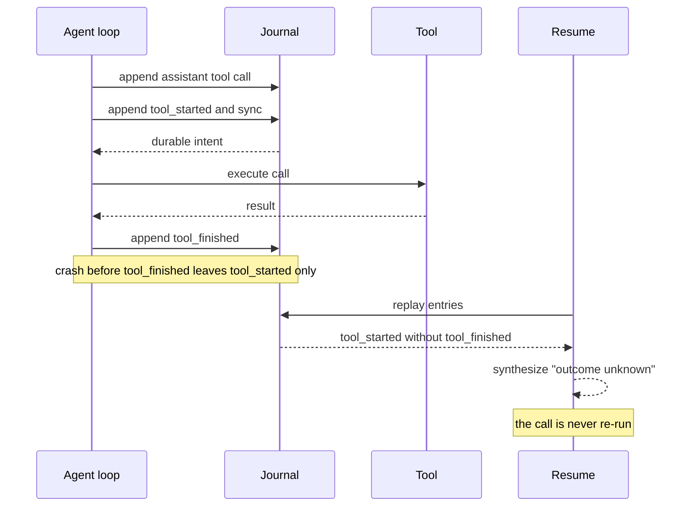

# Sessions and durability

A session is an append-only journal on disk. Runs can be resumed, rewound, served
over a protocol, or driven from Go, and all of them use the same journal and the
same recovery rules.

## Durable journals

Every run is journaled to an append-only JSONL file as it happens: each message,
each tool call's start and finish, per-call usage, and how the run ended. A tool's
start is on disk before the tool runs.

- `-continue -p "new input"` opens the most recent session for this directory.
- `-resume <id> -p "new input"` opens a specific session.
- Without `-p`, `-continue` or `-resume <id>` explicitly continues existing work.
  It resumes accepted input and reconciles interrupted tool calls using their
  recorded replay policy. Safe calls require a compatible implementation.
  Never calls report an unknown outcome instead of running again.
- The CLI prints the id on stderr in text mode and as `session_id` in JSON reports.
- You can pass the journal filename (with or without `.jsonl`) instead of the bare
  id. Ambiguous ids are rejected with filename hints.
- Sessions are isolated by working directory, so a resume never bleeds another
  project's history into yours.

If the process died mid-run, a tool call that had started but not finished comes
back to the model as **"outcome unknown"** and is never re-run automatically. A torn
final line is trimmed.

### Tool call journaling

The intent record is synced before the tool executes. On resume, a start with no
finish becomes an unknown outcome, not a retry.



### Journal format

Journals use format **v4**. Opening a v1, v2 or v3 journal migrates it under a
stable writer lock before new facts are written. Atomic batches include a checksum
and a prior sequence. A torn final batch is absent; invalid middle data is an error.
Older binaries refuse v4. Back up each journal with its lock, `.jsonl.blobs` and
`.jsonl.d` directories. Large transcript and submission batches use immutable,
content-addressed blobs; their references commit only after the blobs are synced.
Missing or modified blobs are corruption. Committed snapshots and child journals
are recovery data, not caches. The `.jsonl.catalog` metadata index is rebuildable.

The JSONL adapter retains the full raw committed history in memory. Read pages
have bounded sizes and immutable sequence cuts, but the adapter is not
disk-indexed and does not have a bounded memory working set. Context compaction
does not remove that retained history.

Fresh prompts in an open session reuse the writer's committed usage receipts;
they don't replay and checksum the entire archive at each run start. Explicit
continuation still loads the archive to recover interrupted logical-run state.

Document namespaces with the `latest` history policy allow only current-value
reads. Historical cuts, revision history, and cursors pinned before later commits
are rejected, including broad queries and extension callback reads.
The agent document stores the effective ordered extension selection, including
required subprocess bundles. Resume fails visibly if one is unavailable; it never
silently drops a safety bundle. Persisted tool choices intersect the operator's
current allowlist and exclusions, so a resume cannot restore removed authority.


### Durable prompt retries

Pass `-request-id KEY` to give a prompt a durable identity. You can retry the
identical command without adding `-continue` or `-resume`:

```sh
tempest -session-dir ./sessions -request-id fix-1 -p "fix the failing check"
```

With no explicit session selector, Tempest finds the session that already holds
the key in that session directory and working directory (the same scope as
`-continue`). It returns the original receipt and answer, or resumes accepted work.
Changed input conflicts; use the same prompt, images, output schema and placement.
A filesystem lock serializes concurrent commands for that key through session
close. A killed process releases the lock; the journal, not the lockfile, owns the
receipt. The rebuildable catalog index accelerates lookup; missing or stale index
data falls back to the committed journal.

With `-resume SESSION` or `-continue`, the selected session owns the key instead.
Keys in different explicitly selected sessions are independent. Text mode prints
the session and submission IDs after acceptance, before waiting for the answer.
JSON and stream-json final reports include `submission_id` and `request_id`.
The keyed CLI command explicitly resumes accepted input that never dispatched.
It does not replay a provider call whose outcome is unknown.

Same-key retries return the original submission, even after consumption,
withdrawal or restart. Changed input conflicts. A withdrawn request stays withdrawn.
A new request needs a new key. Keys have no silent expiry while the session exists.

Acceptance is synced before success is returned. Losing a connection or cancelling
a wait does not withdraw accepted input. After a crash, opening and reading remain
side-effect-free. Explicit continuation or host resume decides whether pending work
runs. Interrupted provider calls and outside effects are not exactly-once promises.

Application state uses the same commit boundary. Document writes support expected
revisions and atomic batches. A failed comparison adopts nothing. File storage
syncs commits; the memory backend deliberately has no crash-durability guarantee.


## Error handling

The run bends, it does not break. Transient provider failures (rate limits, resets,
timeouts) are sorted by a typed error taxonomy and retried with exponential backoff
and jitter. Only genuinely terminal conditions stop the loop, and context overflow
is handed off to compaction instead of failing.

Tool errors take the other road. A stale-anchor edit, a blocked destructive command,
a bad path, or a failing shell command each come back to the model as a clear,
actionable result, so it re-reads, re-anchors, and course-corrects on the next turn
instead of corrupting state.

## Runs

A run is one `-p` prompt. The model calls tools, sees their results, and keeps
going. A reply with no tool calls reaches **quiescence**: the run waits for owned
background jobs and consumes their result follow-ups before completing.

A result follow-up is a short host notice in the transcript: job id, kind, state,
exit code or reason, a bounded output or result preview, artifact paths, and the
`wait`/`logs` calls that return the full details. No detached next run is started
automatically. A `wait` that returns a job settled (finished, its notice queued and
its worktree cleaned up) withdraws that job's pending notice in the same journal
commit that records the wait result, so the model does not read the same result
twice and the run does not take an extra turn for it. The notice still arrives when
the loop had already taken it, and a job whose state reads finished while it is still
wrapping up, which a wait on several jobs can return beside the settled one, keeps
its notice. A crash before that commit leaves the notice pending, and the resumed
session delivers it. A wait outside a model tool call (for example through the Go API) withdraws nothing.

### Stop reasons

Every run ends with one of these:

| Stop reason | Meaning | Exit code |
|---|---|---|
| `completed` | The model replied without calling a tool. | 0 |
| `max_turns`, `max_cost`, `max_wall_time` | A budget tripped. | 0 |
| `aborted` | SIGINT or SIGTERM. Running tools are cancelled and the run waits for them to return before it ends; a second signal kills the process. | 130 |
| `error` | The provider failed, or the session journal could not be written. | 1 |
| `repeated_failure` | The model sent the same tool call, with the same arguments, until it had failed with the same error five times in a row. | 1 |
| `loop_detected` | The model kept repeating a loop (see [Loops](#loops)) after a host notice told it about that loop. | 1 |

### Budgets

Budgets are checked at turn boundaries: after a turn's tools finish and before the
next model call. A budget-stopped run therefore ends on a complete turn, and
`-continue` picks the session up from there. One long turn can overrun
`-max-wall-time`. `-max-cost` is also checked before each request of a compaction
summary, so a summary written in many requests stops at the cap too (see
[compaction](conversations.md#background-and-manual-compaction)).

| Flag | Cap |
|---|---|
| `-max-turns N` | Model calls. Finishing naturally on call N still reports `completed`; the cap stops a run only when another turn or outstanding work remains. |
| `-max-cost USD` | The summed cost of the run's model calls. When the price of a model the run can bill (its model, the plan and smol role models, the MCP sampling model, or a backup of any) is unknown and its route does not report billed cost, the run is refused at startup: an unknown price is not a zero price. On a billed-cost route, a call that comes back without a cost stops the run with that error. |
| `-max-wall-time D` | Elapsed time, as a Go duration such as `10m`. |

At the turn cap, the run checks for pending foreground tasks and job deliveries
without resuming more task phases. An empty task graph doesn't turn a clean final
answer into `max_turns`.

### Repeated failures

A failed tool call sent again unchanged fails the same way, so the loop watches for
it. A failed result that repeats the failure just before it (same tool, same
arguments after JSON canonicalization, same error) gets a host notice appended, from
the second time on, saying how many times in a row the call has failed and that the
arguments or the approach must change.

The fifth identical failure in a row ends the run with `repeated_failure` after that
turn. `error` in the report names the call and its error, and over ACP
`session/prompt` fails with `-32023 repeated_failure`. Any other tool result or a
user message (a new prompt included, a conversation reminder excepted) resets the
count, and a successful result is never changed. The same failure coming back after
other calls is the [loop guard's](#loops). The count is read from the transcript, so continuing a resumed
session (`Session.Continue`, `tempest/continue`) carries it on.

### Loops

A model can also be stuck while its calls succeed, or while other calls come between
its failures: re-reading a file that has not changed, re-running a command with the
same output, flipping between two calls, or giving the same final answer to a Stop
hook that keeps sending it back. The loop guard works from one rule: a loop is
repeated work with no progress in between.

A call is its tool and its arguments after JSON canonicalization; its result is its
outcome (error or not) and content. A call that returns what it returned the last
time is a repeat. A call that returns something new (a first call, or a known call
with a changed answer) is not, and when it succeeded and its tool may change things,
it is progress: an edit, a write, a command, an MCP or extension tool, a subagent,
anything but a workspace read. Progress starts every count over. Workspace reads
(`read`, `grep`, `find`, `ls`, `ast_grep`, `view_image` on workspace paths, not on
`job://`, `history://` or other internal URLs) are never progress: their answer
changes only when something else changed the workspace. A failed call is never
progress either.

| Pattern | Reported when | Default |
|---|---|---|
| `repeated_result` | A failed call, or a workspace read, returned the same result N times with no progress in between. | 3 |
| `repeated_poll` | Any other successful call (a command, an MCP or extension tool) returned the same result N times with no progress in between. Such a call may be polling for a change outside the workspace, so it gets more room. | 10 |
| `repeated_text` | N replies in a row had no tool call and the same text, ignoring case and whitespace, with only Stop, SubagentStop or extension `on_yield` hook feedback between them. | 3 |

So an edit followed by the same test run, whether the test output changes or not, is
never a loop: each new edit is progress. Re-reading an unchanged file between edits
is not either. Two stateful tools whose answers keep changing are not. Re-reading the
same unchanged file three times with nothing changed in between is, and so is A, B, A,
B where both keep giving the same answers.

Each repeat must come within 10 calls of the one before; a call made again after 10
or more other calls starts a new count. Identical calls in one reply
count once: the model made them before seeing any of their results. The checks run
once per tool batch, after its last result, and once before each model call for
repeated text; a pattern is reported only when the newest batch or reply continues it.

The first report of a loop is a notice at the tail of the transcript, starting with
`[Loop notice from the host]`: appended to the batch's last tool result, or for
repeated text sent as a user message after the hook feedback. It names the call and
tells the model to change its approach or say what is blocking it; for
`repeated_poll` it also says how to wait in one call. Counting starts over after a
notice, so the loop has to build up anew. If the same pattern is reported again, for
the same call or one that was repeating with it (the other leg of A, B, A, B), with no
progress since the notice, the host appends a `[Loop stop from the host]` notice and
the run ends with `loop_detected` after that turn. A different pattern gets its own
notice first, and after progress the next report is a notice again. The system prompt
and earlier messages never change, so the cached prompt prefix is kept.

`error` in the report says which loop it was, `loop` in the
[run report](#the-run-report) gives its `pattern`, `tools` and `count`, and over ACP
`session/prompt` fails with `-32026 loop_detected`. Every notice and stop is also
published as a `tempest/loop_guard` update, and a tool result that got a notice (from
this guard or the repeated-failure guard) is sent again as a `tool_call_update` with
its full content, notice included, after the call's completed update.

Waiting is not a loop. `wait`, `jobs`, `logs` and `write_stdin` are polling tools:
their successful calls are never reported. A command polling for a server, such as
`curl -s localhost:8080/health` returning the same "starting" answer, gets nine
unchanged answers with no notice, a notice on the tenth and the stop after ten more
(twenty probes, a few minutes of model turns); an answer that changes starts the count
over. The better way to wait is one call: `timeout 120 sh -c 'until curl -sf URL; do
sleep 2; done'` is a single result whatever it waits for (bounded by `bash_timeout`),
or run the server as a background job and use `wait`. A probe that fails, such as
`curl -sf` while nothing listens, is a failure: the repeated-failure guard stops five
in a row, and between other calls the third identical failure gets this guard's
notice.

The repeated-failure guard keeps its own notice and stop for consecutive identical
failures; the loop guard does not report a result that guard already noted, but still
checks the rest of the batch, so a batch with an unchanged success and repeated
failures cannot slip past both.

Like the failure count, the guard reads everything from the transcript, so a resumed
or replayed session reaches the same decisions and never repeats a notice. Any user
message (a new prompt, a steer, a job notice, a compaction summary) starts the count
over, except a conversation [reminder](skills-and-context.md#reminders), which
restates instructions and is not new input; request-scope reminders never enter the
transcript. `Continue` adds no message, so it carries the count on. After a
`loop_detected` stop, the next repetition of the same loop stops a continued run again
at once, while a model that moved on is not stopped by the loop it left.

The thresholds are the `loop_detection` setting, and `0` turns a pattern off; see
[Configuration](configuration.md#settings-file).

### Background work and shutdown

Background bash and the four management tools ship with ordinary bash; `task`
remains opt-in. Cancellation, `Session.Close`, CLI signals and server shutdown cancel
and join owned jobs before the root terminal event.

This is not a detached process service: no background command is intentionally kept
alive after a clean shutdown. SIGKILL can leave OS descendants running. Recovery
reports their outcome as unknown, never reruns the command and never signals a
stale PID.

### Retries

A model call that fails transiently is sent again, unchanged, after an exponential
backoff (`HARNESS_RETRY_*`; 11 attempts by default). Retries cover HTTP 429 and 5xx,
dropped connections, error events inside a stream, and stalled streams.

A stream has **stalled** when no SSE event arrives for 5 minutes before the model's
first output (queueing, or reasoning the model does not stream) or for 90 seconds
once output has started. Keep-alive comments do not count, so a proxy holding a hung
upstream open is still caught.

Sending the call again after part of a reply was streamed is safe because tool calls
run only once a reply is complete. The abandoned attempt ends as an errored assistant
message, in the transcript and the journal, carrying whatever usage the provider
reported for it. OpenAI-compatible routes report usage only at the end of a stream,
so a stalled attempt there records none, and its `responseId` is kept for looking up
the bill. The abandoned message is never sent back to the model: the next attempt
starts a new message. Stderr logs `assistant stream retry` with the attempt, the
delay and the cause.

Cancellation and other 4xx failures (authentication, invalid request, context
overflow) are not retried. When the attempts run out, the run stops with `error`
naming the attempt count and the last cause, unless the role has
[backup models](providers.md#backup-models): then the next backup gets the same
request, and the run stays on it until it ends. The switch is journaled as
`model_fallback` before the backup is called, so a crash at any later point resumes
on the backup, and a switch the journal cannot record stops the run instead.

## Output formats

The three output modes are `text`, `json` (a pretty-printed report), and
`stream-json` (one compact JSON object per line). `-print` remains a legacy alias;
`-output-format` wins when both are supplied.

In text mode the last assistant text goes to stdout, and a stop reason other than
`completed` goes to stderr. Text mode ends with
`session: <id> (resume with -resume <id>)` on stderr.

### The run report

`-output-format json` prints a run report:

```json
{"session_id": "d6b6fcd56cee7675", "stop_reason": "max_turns", "turns": 3, "usage": {"input": 5120, "output": 410, "...": "..."},
 "cost_usd": 0.0213, "elapsed_ms": 18450, "text": "last assistant text", "message": {"role": "toolResult", "...": "..."}}
```

`cost_usd` is `null` when any call's price was unknown. `error` appears on `error`,
`output_invalid`, `repeated_failure` and `loop_detected` stops, and `loop`
(`pattern`, `tools`, `count`, `action`) on `loop_detected`. `message` is the
transcript's last message.

### Structured final answers

`-output-schema FILE` makes the run's final answer one JSON value that satisfies the
JSON Schema in FILE. The provider is asked for native structured output
(OpenAI-compatible `response_format: {type: json_schema, strict: true}`, Anthropic
`output_config.format`, Gemini `responseJsonSchema`). Tool calls stay free, so the
agent still works before it answers.

The prompt also carries the schema, and the final text is validated locally with the
same validator as a task's `output_schema`. An invalid answer gets one correction
turn naming the validation error. If it still fails, the run stops with
`output_invalid` and exits 1. The report's `output` field holds the parsed value.

Write strict schemas (`additionalProperties: false`, every property required):
OpenAI's and Anthropic's native modes require them. In Go, set
`Prompt.OutputSchema` and read `RunResult.Output`. Over ACP, send
`_meta.tempest.outputSchema` on `session/prompt` and read `_meta.tempest.output`
from the response.

## Streaming updates

```sh
./bin/tempest -p "Explain this package" -output-format stream-json
```

Stream event lines are the existing Tempest Update envelope:

```json
{"seq":1,"at":"...","sessionId":"...","update":{...}}
```

The last line is the report above, compact, identified by `stop_reason`, with no
extra wrapper or sequence number. Resuming streams only the new run, not old
conversation history.

A slow consumer never blocks the agent. If the 256-update queue overflows, stdout
contains the actual `tempest/gap` marker and the final report, stderr explains the
incomplete stream, and the command exits 1. A broken pipe cancels and joins the run.

Streams include the same `tempest/queue`, `tempest/job`, `tempest/job_output`,
`tempest/message`, `tempest/compaction`, `tempest/model_fallback` and
`tempest/loop_guard` updates as ACP and Go watchers. `tempest/model_fallback` carries
`runId`, `from`, `to`, `reason`, `attempts` and `fallbackIndex`; `tempest/loop_guard`
carries `runId`, `pattern`, `tools`, `count` and `action` (`nudge` or `stop`). Output
events only announce byte availability; read
command logs separately. Child transcripts and thinking are not forwarded into the
parent stream, but every agent-to-agent message is, as `tempest/message`. The final
run-report shape is unchanged.

## Related pages

- [Checkpoints and rewind](checkpoints.md)
- [Permissions](permissions.md)
- [Servers and protocols](serve-and-protocols.md)

[Guide index](README.md) · [Tempest](../README.md)
