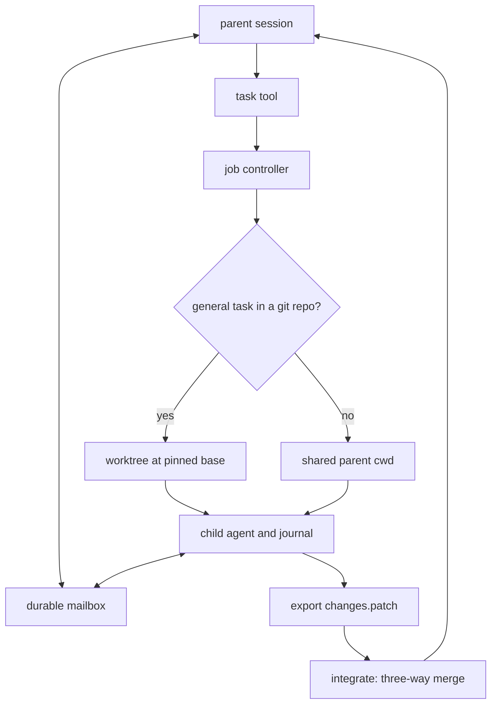

# Subagents and background jobs

`-enable-task` adds asynchronous children, agent-to-agent messages, and worktree
integration. Background bash jobs, services, stdin and pseudo-terminals are part of
the ordinary `bash` tool.

## Task children

`-enable-task` registers the asynchronous `task` tool with two built-in subagent
types:

| Type | Role | Behavior |
|---|---|---|
| `explore` | `smol` | Read-only investigation. |
| `general` | default | Full coding. |

`task` returns a durable job handle immediately rather than waiting for the child's
answer. Children have their own durable journals, cannot delegate again, and inherit
only selected built-ins. Their launch-time permission ceiling intersects the
parent's live policy at every call. Child approval requests route to the root
prompter with allow-once and reject-once only.

Selected extension bundles can add versioned named agent presets. Pass
`<bundle>/<preset>` as `subagent_type`. The host resolves the stored preset ID
and version, applies its instructions and model, and intersects its allowed tools
with the same child ceiling. `explore` and `general` remain built-in presets.
Preset definitions are data, not executable project configuration. See
[extensions](extensions.md).

### Worktrees and isolation

A general child in an eligible git repository gets a **detached worktree**. A clean
tree pins HEAD. A dirty tree pins a snapshot of tracked, staged and nonignored
untracked content using a temporary private index. Parent files and index are not
changed. The snapshot stays reachable through `refs/tempest/jobs/<jobID>` until
cleanup.

Non-git, unborn, bare, sparse or submodule workspaces (including missing git) run
**unfenced in the parent cwd**, with `isolation:"shared"` and at most one active
shared general child per session. `explore` remains read-only in the live cwd.
Worktrees fence cooperative writes, not arbitrary shell commands or hostile code.

Children export binary-capable patches against their pinned base; they never merge
into the parent on their own. Inspect the full job through `WaitJobs` or
`tempest/wait`, or read the patch at the artifact path in the job's completion
notice.

### Integration

`integrate {"job_id": ...}` brings a finished child's work in with a **three-way
merge** relative to the base the child started from, so parent and child edits to
different parts of one file both survive:

1. The parent's current files (uncommitted and untracked ones included, ignored ones
   excluded) are snapshotted into a tree through a private index. The child's tree is
   rebuilt by applying its patch to its base in another private index.
   `git merge-tree --write-tree` merges the two in the object database. The user's
   index, HEAD, refs and working files are never touched, and no worktree is checked
   out. The only residue is unreferenced objects `git gc` prunes.
2. Each file the child changed is reported as `clean` (only the child changed it),
   `merged` (both changed it, without overlap) or `conflict` (overlapping edits,
   shown as numbered diff3 marker hunks labelled parent, base and child; also symlink
   or submodule changes). Nothing is written while any file conflicts. The live file
   keeps the parent's side and the model carries the child's side over with `edit` or
   `hashline`. The full conflicted file stays readable with
   `git show <merged_tree>:<path>`.
3. A textually clean merge is not proof the code still works together, so merged
   files are written only when the call passes `accept_merged:true`. Before writing,
   every target is re-hashed under the file mutation locks; a file that changed since
   the snapshot refuses the whole integration with what changed. The write goes
   through workspace containment, the mutation queue, language server change notices
   and, for more than one file, the edit rollback journal.

`integrate` needs git and a root session with the job controller. In a workspace
without git it says so and points at the patch to apply with the edit tools.

Dirty worktrees are retained. `CleanupJob`, `tempest/cleanup_job`, or `jobs` with
`action:"cleanup"` remove only owned, safely exported trees. Missing or corrupt
patches, unique ignored files, or an uncertain surviving crash process block cleanup.
Shared jobs have no patch and no worktree cleanup.

### Task flow

A general task runs in a worktree pinned to its base, or in the parent cwd when no
eligible repository exists. The child exports a patch, and `integrate` merges it
three ways. Messages travel through a durable mailbox.



### Admission limits

| Limit | Value |
|---|---|
| Running jobs per kind (task, bash) | 4 |
| Jobs running or holding an undelivered completion notice | 8 |
| Jobs per run | 64 |
| Retained general-task worktrees | 16 |
| Unisolated general tasks at a time | 1 |

A refused `task` or background `bash` fails with `job_limit:` followed by which
limit is full, the job ids holding it, and the call that frees one (`wait`,
`cancel`, ending the turn to receive pending notices, or `jobs` cleanup). Invalid
task or command input names the field to fix.

## Messages between agents

With `-enable-task`, the root and its running task children can talk through the
`message` tool:

```json
{"to":"parent"|"<job id>"|"all","body":"...","await_reply_ms":N}
```

A send returns as soon as the message is durably in the recipient's mailbox. It
never waits for the recipient to answer unless `await_reply_ms` (at most 300000) is
set, in which case the call also returns the recipient's first message back
(`reply`) or `reply_timed_out:true`. An awaited reply goes only to that call, never
also into the transcript as a note.

From the root, `all` is every running child. From a child it is the parent plus
running siblings, because a child coordinating a shared resource needs to reach both.

A message is a **steering item** in the recipient's own durable queue. A busy agent
reads it at its next step boundary without being interrupted, and a root idling on
its children is woken the way a completion notice wakes it. A child that is about to
finish with a message pending takes another turn instead. Once a child has finished,
sending to it fails with its state.

The recipient sees host text marked `[Message from parent]`,
`[Message from job_… (child)]` or `(sibling)`, with the body flagged as untrusted and
the `message` call to reply with. Each agent holds at most 100 unread messages;
bodies are at most 8 KiB. Messages are journaled with idempotency keys derived from
the sending tool call, so recovery delivers each exactly once. Plan mode denies
`message` like `task`.

## Background jobs

`bash` runs a plain command in the foreground and returns its output. Giving it a
`name`, unique among the session's running jobs, starts the command as a background
job instead and returns the job handle at once. `async:true` does the same for an
unnamed job, and a name or readiness field implies it, so there is no
foreground/background mismatch to reject.

A named job without a readiness condition is ordinary background work: the bash
timeout bounds it and a one-shot run waits for it to finish.

### Readiness conditions

Readiness conditions make the job a **service**:

- `ready_log`: an RE2 regex matched against each output line.
- `ready_port`: a TCP port on 127.0.0.1.
- `ready_timeout_ms`: default 30000, at most 300000.

With a condition the call returns once every condition holds, with
`readiness:"ready"` and the matched line or port in `ready_match`. If the process
exits first, or the deadline passes (the process is then killed, reason
`ready_timeout`), the call fails with the output tail.

A ready service does not keep the run open. It runs until it exits, until it is
cancelled, or until the run ends, which stops it. Unless `timeout` is given it is not
bounded by the bash timeout.

`jobs` lists `name` and `readiness`. `cancel` and `logs` take `name` in place of
`job_id`, and `wait` takes `names` besides `job_ids`. A name resolves to its running
job, else the one started last. Starting a name that is already running fails with
the job holding it; restart a service with `cancel {"name":…}` and start it again.

A job call that names no job, or an id or name the session does not have, fails with
the session's jobs (id, name, kind, state, newest first) or, when there are none,
with how to start one. `ready_timeout_ms` without `ready_log` or `ready_port` is
rejected rather than ignored: it bounds a readiness wait, and to wait for a job to
finish you call `wait`.

Like the foreground command, a background job writes stdout and stderr to one pipe,
as under `2>&1`, so `logs` and `write_stdin` show them interleaved in the order the
command wrote them. A bash job's `result_text` (in `wait`, `jobs` and the completion
notice) is the end of its output, where a failing command prints its error. `logs`
pages the whole of it.

## Interactive jobs

A background job's stdin is `/dev/null`, as for any background process. A command
that reads input (a credential or host-key prompt, a y/n installer, bare `cat`) sees
end of file and fails fast instead of waiting out its timeout. Only a job started
with `stdin:true` (a pipe, which also makes it a background job) or `pty:true` takes
input. `write_stdin` with text to any other job fails and says to start it with one
of those.

### stdin

`write_stdin {"name":…, "text":…}` writes the text as given (`\n` ends a line,
`\u0003` is Ctrl-C) and returns the output the job printed since the previous
`write_stdin` on it. It waits until new output has been quiet for 0.3 s, until
`wait_ms` (default 2000, at most 30000) passes, or until the job's output ends. It
returns at most the newest 16 KiB with raw `offset`/`next_offset`; bytes it skipped
stay readable with `logs`. Empty text polls any background job. `close_stdin:true`
ends the input after the text.

### Pseudo-terminals

`pty:true` starts the job on a pseudo-terminal (stdlib ioctls on darwin and Linux, no
dependency). The process is a session leader whose controlling terminal is 24x80,
with `TERM=dumb`, `NO_COLOR=1` and `cat` as pager, so REPLs and prompting tools run
as they do for a person without painting the log. The terminal echoes input and ends
lines with `\r\n`, and nothing is stripped. Ctrl-C reaches the foreground program
through the line discipline. On a pipe job, with or without `stdin:true`, text that
is exactly `\u0003` sends SIGINT to the job's process group instead. `close_stdin`
closes a pipe job's stdin and sends Ctrl-D on a pty.

Cancellation, timeouts and output bounds are those of every background job, and the
pty is closed once the job's output is drained. A process is never reattached after a
restart: a pty job interrupted by one settles as `unknown` like any other bash job,
and `write_stdin` to it says so. Children have no background jobs, so they get
neither `pty`, `stdin` nor `write_stdin`.

### Permissions for interactive jobs

`write_stdin` is in the `exec` tier: plan mode denies it, and a `write_stdin`
override (`prompt`, `deny`) applies to every call.

The destructive guard and cloud analysis cannot see what a program does with its
input, so `default` mode allows a write the way it allows the program's own command.
The job's command already passed the gate. A shell reading commands from stdin
(`bash`, `sh -s`) is opaque there, so starting one needed per-call approval (and is
denied without an approver). Approving such a shell approves what is typed into it.

[Guide index](README.md) · [Tempest](../README.md)
